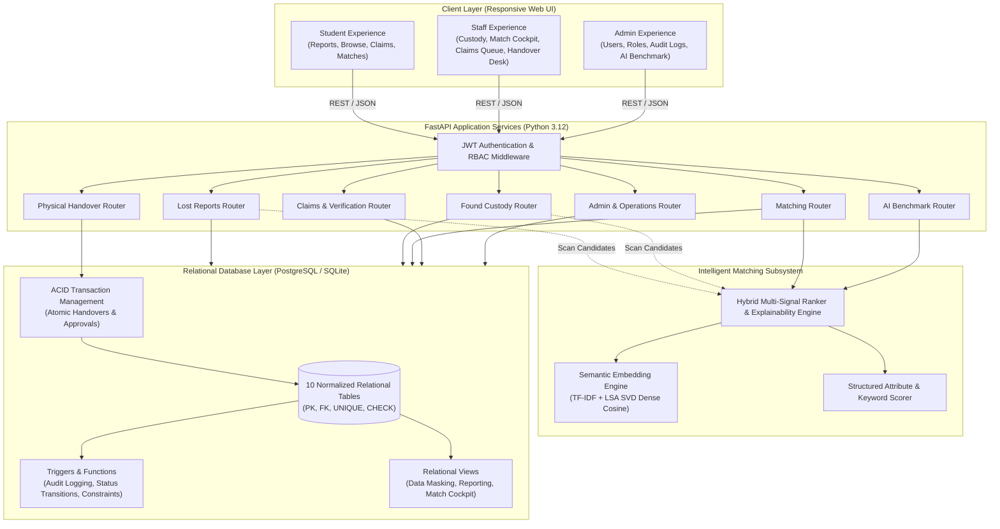
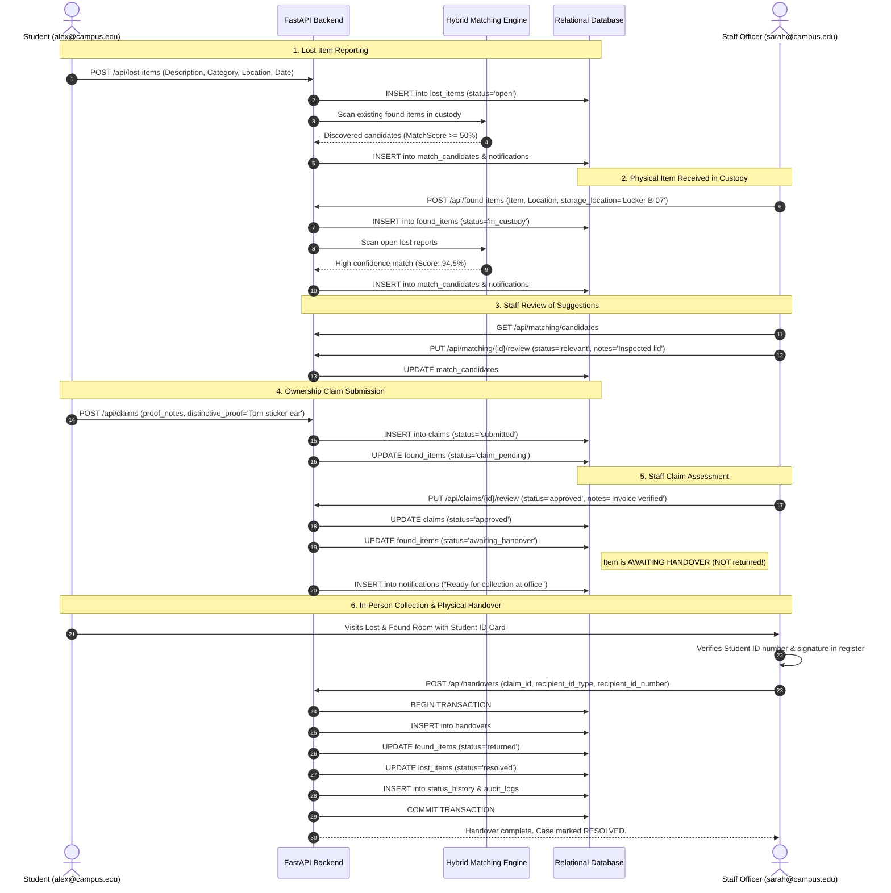

# System Architecture & Technical Design
## Lost & Found Intelligence System for a University Campus

### 1. High-Level Architectural Overview

The system employs a clean, modular multi-tier architecture separating presentation, REST application services, intelligent signal processing, and relational data persistence.

---

### 2. Component Responsibilities

#### 2.1 Web Presentation Layer (`frontend/`)
- **Single Page Application (SPA):** Delivered directly by FastAPI with zero build tool dependencies, guaranteeing offline execution on any machine.
- **Dynamic Role Adaptation:** Switches UI capabilities based on active user role (`student`, `staff`, `admin`).
- **Interactive Modals:** Handles lost reporting, official found receipt, evidence submission, claim review, physical handover recording, and live benchmark execution.
- **Data Confidentiality:** Masks physical custody storage codes and finder contact details from students.

#### 2.2 Application Services Layer (`backend/app/`)
- **FastAPI Core (`main.py`):** Configures routing, CORS, static file mounts, database lifecycle events, and error handling.
- **Security & RBAC (`auth.py`):** Issues signed JWT tokens (HS256) and enforces role-based endpoint guards via FastAPI dependency injection (`require_role(["staff", "admin"])`).
- **Data Transfer & Validation (`schemas.py`):** Enforces Pydantic v2 schemas validating payload lengths, regex constraints, and required fields.
- **Relational ORM (`models.py`, `database.py`):** SQLAlchemy 2.0 object-relational mapping establishing exact relational constraints, foreign keys, cascades, and checks.

#### 2.3 Intelligent Candidate Matching Subsystem (`backend/app/matching/`)
1. **Baseline Keyword/Structured Matcher (`baseline.py`):**
   - Filters exact category compatibility.
   - Computes token overlap (Jaccard similarity + length-normalized overlap) across descriptions, brands, and colors.
   - Computes temporal difference in days with smooth decay.
   - Computes registered location ID match or text proximity.
2. **Semantic Dense Vector Engine (`semantic.py`):**
   - Projects raw text into a dense semantic space using TF-IDF word & character n-grams (1-3) fitted across a campus domain vocabulary.
   - Computes Cosine Similarity:
     $$\text{CosineSim}(\mathbf{u}, \mathbf{v}) = \frac{\mathbf{u} \cdot \mathbf{v}}{\|\mathbf{u}\|_2 \|\mathbf{v}\|_2}$$
   - Produces a continuous semantic score $[0, 100]\%$.
3. **Hybrid Multi-Signal Ranker (`hybrid.py`):**
   - Combines signals with weighted multi-criteria aggregation:
     $$\text{MatchScore} = 0.35 \times \text{Semantic} + 0.25 \times \text{Keyword} + 0.40 \times \text{Structured}$$
   - Structured sub-score includes Category (40%), Brand match (20%), Color match (15%), Location proximity (15%), and Temporal window (10%).
   - Generates transparent JSON reasoning strings detailing each signal for staff inspection.

---

### 3. End-to-End Item Lifecycle Workflow

The lifecycle strictly decouples match suggestion, claim evaluation, approval, and physical collection:

