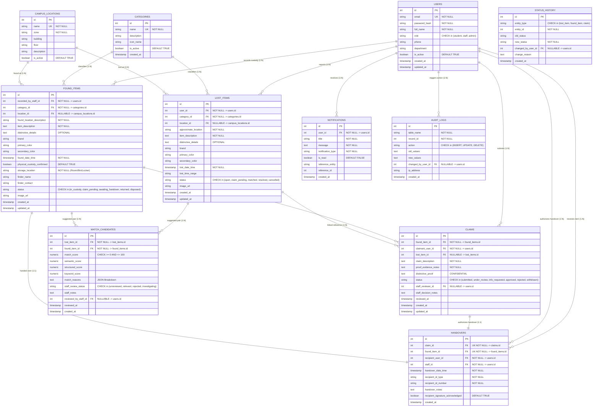

# Entity-Relationship Diagram (ERD)
## Lost & Found Intelligence System for a University Campus

### 1. Visual Entity-Relationship Diagram (Mermaid)

---

### 2. Relationship Cardinality & Referential Integrity Matrix

| Parent Table | Child Table | Relationship | Foreign Key Column | On Delete Action | Integrity Justification |
| :--- | :--- | :--- | :--- | :--- | :--- |
| `users` | `lost_items` | $1 : N$ | `user_id` | `CASCADE` | If a user account is deleted, their reports are removed. |
| `users` | `found_items` | $1 : N$ | `recorded_by_staff_id` | `RESTRICT` | Prevents deleting staff accounts responsible for physical custody. |
| `categories` | `lost_items` | $1 : N$ | `category_id` | `RESTRICT` | Prevents deleting a category actively referenced by open reports. |
| `categories` | `found_items` | $1 : N$ | `category_id` | `RESTRICT` | Protects categorical integrity of inventory. |
| `campus_locations` | `lost_items` | $1 : N$ | `location_id` | `SET NULL` | Removing a campus location does not invalidate the report description. |
| `lost_items` | `match_candidates` | $1 : N$ | `lost_item_id` | `CASCADE` | When a lost item is removed, generated candidate matches are cleared. |
| `found_items` | `match_candidates` | $1 : N$ | `found_item_id` | `CASCADE` | When a found item is removed, generated candidate matches are cleared. |
| `found_items` | `claims` | $1 : N$ | `found_item_id` | `RESTRICT` | Prevents deleting an item currently subject to active ownership claims. |
| `users` | `claims` | $1 : N$ | `claimant_user_id` | `CASCADE` | Deleting a user account cleans up their pending claims. |
| `claims` | `handovers` | $1 : 1$ | `claim_id` | `RESTRICT` (UNIQUE) | Strictly guarantees an approved claim is handed over exactly once. |
| `found_items` | `handovers` | $1 : 1$ | `found_item_id` | `RESTRICT` (UNIQUE) | Strictly prevents handing over the same physical found item twice. |

